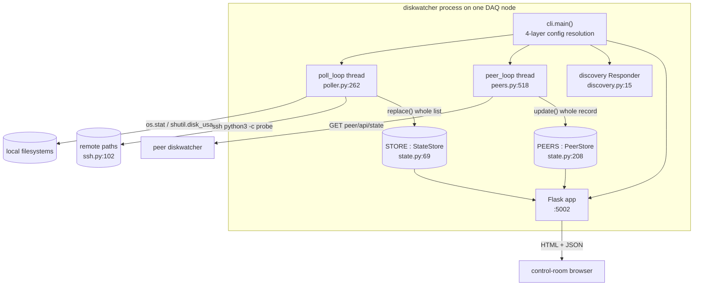
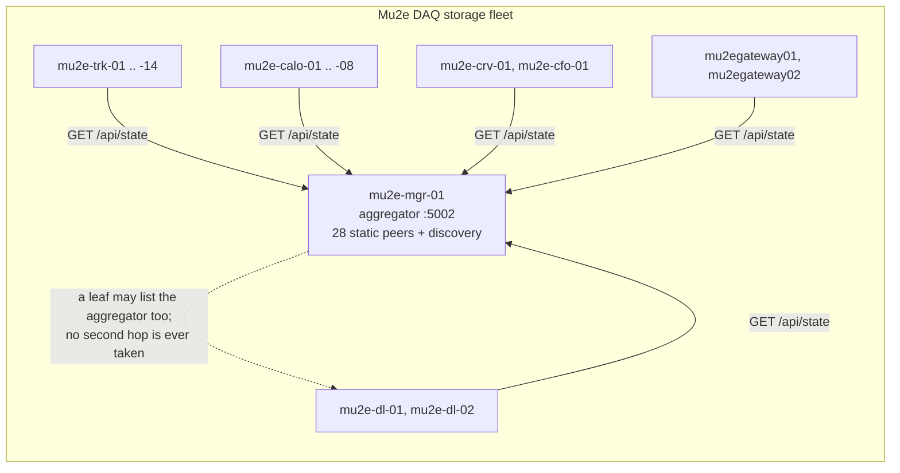
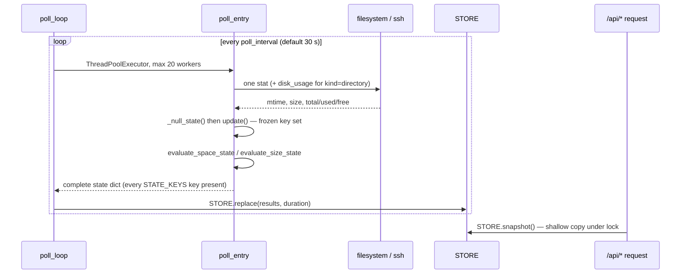

# mu2edaq-diskwatcher

> Measure-only monitor of file mtime freshness, filesystem free space and file sizes, serving three dashboards and a JSON API on port 5002, with one-hop HTTP federation across the DAQ node fleet

| | |
|---|---|
| Repository | `Mu2e/mu2edaq-diskwatcher` |
| Language | Python 3.9+ (Flask, PyYAML; stdlib elsewhere) |
| Version | 1.3.0 (`src/mu2edaq_diskwatcher/__init__.py:20`) |
| Ports | 5002/tcp (web UI + JSON API); 28999/udp multicast 239.255.42.99 via `mu2edaq-discovery` |
| Depends on | `mu2edaq-discovery` (optional), `mu2edaq-operations` / `crs-app` (launcher) |
| Counterpart | `mu2edaq-file-reaper` — diskwatcher measures, the reaper actuates |

## Purpose

diskwatcher answers three questions about a DAQ node's storage, independently,
for every configured path:

1. **Is this path still being written?** `now - mtime > delay` marks it `stale`
   (`src/mu2edaq_diskwatcher/poller.py:193`).
2. **Is this filesystem running out of room?** `space:` thresholds on a
   directory classify the *free* bytes into `GOOD/WARNING/CRITICAL/FULL`
   (`src/mu2edaq_diskwatcher/thresholds.py:173`).
3. **Has this file grown too large, or been truncated to zero?** `size:`
   thresholds on a file classify its length, with `EMPTY` checked first
   (`src/mu2edaq_diskwatcher/thresholds.py:202`).

It is **measure-only**. There is no delete path, no move, no rotation, no
notification transport. The only writes it performs are its own pid file and
log file (`src/mu2edaq_diskwatcher/daemon.py:75`). This is the deliberate
division of labour with `mu2edaq-file-reaper`, which actuates on the same
volumes; keeping the measuring side incapable of destruction means a
diskwatcher misconfiguration produces a wrong colour on a dashboard, never a
lost run.

## Architecture

Three long-lived threads plus the Flask request threads, sharing two
lock-guarded stores. No database, no queue, no IPC.



### Federation topology: one hop, deliberately

The property that makes a mutually-listing fleet terminate is that a peer is
asked for `/api/state` **without** `?peers=1`:

```
STATE_PATH = "/api/state"          # src/mu2edaq_diskwatcher/peers.py:50
```

and the comment on the line above states the intent: *"Deliberately without
`?peers=1`"*. The endpoint honours that — `api_state` only appends the `peers`
and `aggregate` keys when `_want_peers()` is true, which reads the query string
(`src/mu2edaq_diskwatcher/web/api.py:83`, `:161`). A peer therefore returns its
own entries and nothing further away. **This is enforced in code, not by
convention**, and it is why the aggregator may list all 28 leaves while any
leaf may also list the aggregator without producing an infinite regress or a
path appearing three times.

A second guard closes the degenerate self-loop: both sides publish a random
per-process `INSTANCE_ID` (`src/mu2edaq_diskwatcher/__init__.py:29`), and a
fetch whose payload carries our own id is rejected as
`"peer is this instance (the URL resolves to ourselves)"`
(`src/mu2edaq_diskwatcher/peers.py:135`).



### The measurement loop



Two invariants hold this together and are asserted by the tests:

- **Frozen key set.** Every entry is built from `_null_state(entry)` and only
  ever `update`-d, so the error branch cannot omit a key the success branch
  emits (`src/mu2edaq_diskwatcher/poller.py:34`, `STATE_KEYS` at `:98`). The
  previous design patched the error path by hand and leaked `undefined` into
  the browser.
- **Whole-object replacement.** `StateStore.replace` swaps in a brand-new list
  of brand-new dicts and `snapshot` returns a shallow copy
  (`src/mu2edaq_diskwatcher/state.py:40`). A reader can never observe a
  half-written entry. The module docstring explicitly forbids "optimising" the
  poller to mutate in place.

## Components

| Module | Lines | Role |
|---|---|---|
| `cli.py` | 304 | Argparse, four-layer config resolution, thread startup |
| `config.py` | 516 | YAML parsing, watch-entry and peer construction; never raises, never exits |
| `settings.py` | 277 | The mutable process-wide `Settings` singleton and env mapping |
| `poller.py` | 269 | The measurement loop and per-entry state derivation |
| `thresholds.py` | 246 | Pure threshold parsing and the two state evaluators |
| `ssh.py` | 189 | Single-round-trip remote probe with a per-host `stat` fallback |
| `peers.py` | 535 | HTTP peer fetch, discovery scan/probe, grace expiry |
| `state.py` | 269 | `StateStore`, `PeerStore`, summary functions |
| `discovery.py` | 38 | The `mu2edaq-discovery` responder, best-effort |
| `web/api.py` | 316 | Eight JSON endpoints |
| `web/views.py` | 117 | Six HTML pages |
| `web/static/diskwatcher.js` | 686 | Client-side sort, group, filter, auto-refresh |

### Configuration precedence

Resolved once in `cli.main()`, lowest priority first
(`src/mu2edaq_diskwatcher/cli.py:153`–`:219`):

```
dataclass defaults  →  YAML config file  →  MU2EDAQ_DISKWATCHER_*  →  command line
```

The mechanism is that every argparse default is `None`, and `Settings.apply`
skips `None` values (`src/mu2edaq_diskwatcher/settings.py:173`). The peer list
is layered by *replacement*, not merge: YAML `peers:`, then
`$MU2EDAQ_DISKWATCHER_PEERS`, then `--peer`, each discarding the previous.

Path placeholders (`{host}`, `{hostname}`, `{port}`, `{user}`, `{run_dir}`) are
expanded *after* every layer, because `{port}` depends on the final web port
(`src/mu2edaq_diskwatcher/settings.py:233`). The default run directory is
`run/{host}` — the checkout is commonly on NFS and shared by several DAQ nodes,
so everything written at runtime is keyed by node or two machines would
overwrite each other's pid file.

## Interfaces

See `docs/INTERFACES.md`. In brief: eight JSON endpoints under `/api`, six HTML
pages, one outbound HTTP contract (the peer fetch), one outbound SSH contract
(the remote probe), and one optional UDP discovery integration.

## Configuration

See `man/man5/mu2edaq-diskwatcher.conf.5` (718 lines) for the full schema and
`README.md` §Configuration for the tutorial treatment.

The fleet is configured from `config/nodes/node.template.yaml` through
`tools/make-node-configs.sh`, which renders 27 per-node files plus, from
`config/nodes/aggregator.template.yaml`, the aggregator config in `config/`.
All 27 generated files were verified byte-identical to a fresh render of the
template during this review — there is no drift.

Every threshold in the shipped templates is a **percentage**. The template
comment at `config/nodes/node.template.yaml:74-82` records why: a mixed block
such as `10% / 5% / 500 GiB` resolves misordered on a 50 GiB disk and read
`FULL` on an empty disk across 27 nodes on 2026-09-23. `check_order` at poll
time (`src/mu2edaq_diskwatcher/poller.py:118`) now flags such a block, and
`tests/test_packaging.py` sweeps 10 GiB to 64 TiB to hold the templates
pure-percentage.

## Operations

See `docs/OPERATIONS.md`.

## Interactions with other packages

| Package | Direction | Mechanism | Evidence |
|---|---|---|---|
| `mu2edaq-discovery` | out (optional) | `import`, UDP multicast + unicast probe | `src/mu2edaq_diskwatcher/discovery.py:21`, `peers.py:184` |
| peer `mu2edaq-diskwatcher` instances | out | HTTP GET `/api/state` | `src/mu2edaq_diskwatcher/peers.py:50` |
| DAQ nodes with remote watch entries | out | `subprocess` `ssh` | `src/mu2edaq_diskwatcher/ssh.py:54` |
| `mu2edaq-operations` (`crs-app`) | in | invokes `start-mu2edaq-diskwatcher.sh`, exports `CRS_PORT_HTTP` | `start-mu2edaq-diskwatcher.sh:26` |
| `mu2edaq-file-reaper` | none (conceptual) | no code path; the reaper actuates where diskwatcher measures | — |

There is **no** direct coupling to the file reaper: no shared database, no
socket, no import. The relationship is operational — an operator watching a
`CRITICAL` volume here decides whether the reaper should run — and documenting
it as a code dependency would be wrong.

## Review findings

Filed against `Mu2e/mu2edaq-diskwatcher` by the September 2026 mega-review; see
`docs/package.yaml` `findings[]` for issue URLs and fingerprints. Summary:

| Severity | Finding |
|---|---|
| S2 | An 8,815-line Flask access log with an absolute developer path is committed at `config/mu2edaq-diskwatcher.log`, defeating `.gitignore`'s `*.log` |
| S3 | 13 test files / 314 test functions and no CI workflow whatsoever |
| S3 | The 28-node list is a fourth, independent copy of the cluster topology; it disagrees with `mu2edaq-operations` and `mu2edaq-power-recovery`, which say 18 trackers and 14 calorimeters |
| S3 | `ssh.options` given as a bare list of `Key=Value` (the form every doc shows) is passed to `ssh` without `-o`, producing a bad command line |
| S3 | `--discover-peers` federates any responder advertising `app=diskwatcher`, with no authentication and an empty default `exclude` |
| S4 | `bootstrap_diskwatcher.sh` deviates from the `bootstrap-<app>.sh` naming convention |
| S4 | Flask's development server is used as the production WSGI server with no note in the docs |
